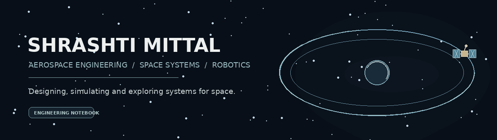

[GitHub](https://github.com/shrashtimittal) · LinkedIn and professional contact details can be added once the preferred public links are confirmed.

---

## Hello, I'm Shrashti.

I'm an aerospace engineer pursuing a Master's in **Space and Astronautical Engineering at Sapienza University of Rome**. I enjoy working across spacecraft systems, orbital mechanics, robotics, embedded systems and computational methods.

I like taking ideas from a first technical question to a working model: researching the problem, building the software or hardware, testing assumptions and documenting what the results actually show.

## Areas I explore

| Space systems | Robotics & embedded | Computational engineering |
|:--|:--|:--|
| Spacecraft and mission design | Autonomous UAV systems | Python and scientific computing |
| Orbital mechanics and navigation | Pixhawk, ESP32, Arduino | AI / machine learning |
| Satellite systems and analysis | Sensor integration and drivers | Modelling and simulation |

## Selected work

> A selection of projects from my GitHub. Each repository should include its own methodology, implementation details, limitations and reproducible instructions.

### Space & mission engineering

- **[QRNG Spacecraft Navigation](https://github.com/shrashtimittal/qrng-spacecraft-navigation)** — A Python/Qiskit exploration of quantum-randomness concepts in spacecraft navigation noise and drift simulation. *Exploratory simulation; not flight-validated navigation technology.*
- **[HELIO-OPS Guardian System](https://github.com/shrashtimittal/HELIO-OPS-Guardian-System)** — A space-weather and satellite-risk monitoring concept. See the repository for the implemented data sources, assumptions and model limitations.
- **Smart CubeSat project** — Satellite systems and engineering work. Add its public repository link when the project repository is ready to be featured.

### AI, machine learning & software

- **[Fraud Transaction Detection](https://github.com/shrashtimittal/fraud-transaction-detection)** — Machine-learning classification for potentially fraudulent transactions.
- **[Animal Image Classification](https://github.com/shrashtimittal/animal-image-classification)** — Deep-learning image classification.
- **[ASL Sign Language Detection](https://github.com/shrashtimittal/asl-sign-language-detection)** — Computer-vision exploration for American Sign Language alphabet detection.

## Research interests

Spacecraft systems engineering · Mission design and analysis · Orbital mechanics · Autonomous systems · Space navigation · Scientific computing · Astrophysics.

I have also worked on independent research manuscripts spanning astrophysics, orbital concepts and theoretical physics. I distinguish ongoing manuscripts from peer-reviewed or formally published work.

## Tools & technologies

**Programming:** Python · C/C++

**Simulation & engineering:** GMAT · Qiskit · CAD / modelling tools *(list specific tools and proficiency in each project README)*

**Hardware & embedded:** Pixhawk · Raspberry Pi · Arduino · ESP32 · STM32

**Workflow:** Git · GitHub · VS Code · Jupyter

## Currently focused on

- Deepening my understanding of spacecraft design and mission engineering.
- Developing reproducible simulations and documenting their assumptions.
- Exploring the intersection of autonomous systems, navigation and space technology.

## GitHub activity

---

*Curiosity is the beginning of every mission.*

