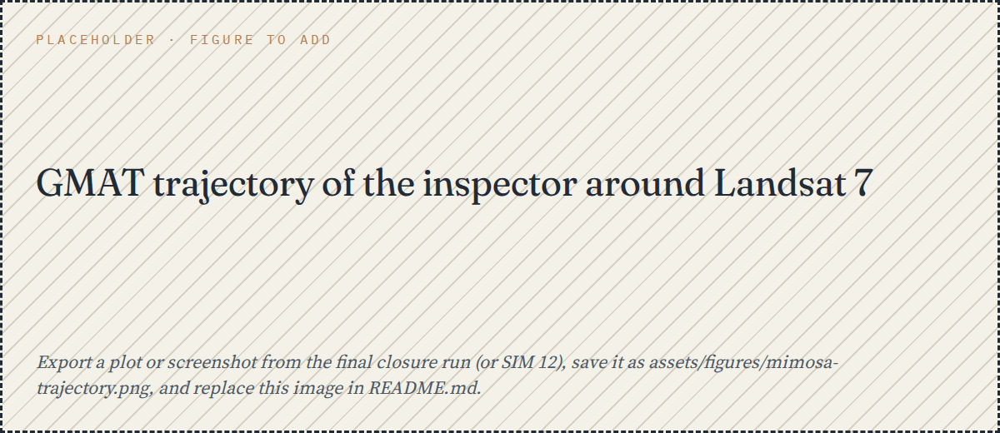
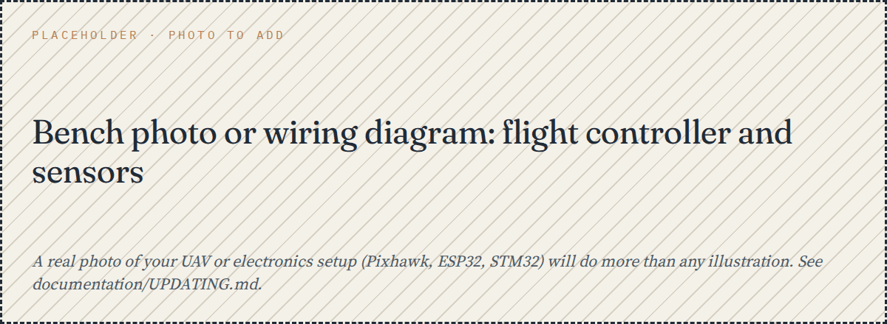

<picture>
  <source media="(prefers-color-scheme: dark)" srcset="assets/hero/hero-dark.png">
  
</picture>

<a href="#on-my-workbench">Workbench</a> &nbsp;·&nbsp; <a href="#projects">Projects</a> &nbsp;·&nbsp; <a href="#robotics-and-embedded">Robotics</a> &nbsp;·&nbsp; <a href="#research">Research</a> &nbsp;·&nbsp; <a href="#toolbox">Toolbox</a> &nbsp;·&nbsp; <a href="#contact">Contact</a>

I'm Shrashti, an aerospace engineer pursuing a Master's in Space and Astronautical Engineering at Sapienza University of Rome. What I enjoy most is the moment a question about a spacecraft turns into something I can run: an orbit, an estimator, a risk model. Most of what's on this page is simulation and software, and some of it is unfinished. I've tried to say which.

## On my workbench

- **Now:** settling into the MSc at Sapienza (2026–2028).
- **Just finished:** the SHE ORBITS 2026 Space Exploration Summer School, where a team of three of us studied how a small inspector satellite could look at Landsat 7 (below).
- **Where this page is thin:** hardware. I work with Pixhawk, ESP32 and STM32 boards, but none of that is written up here yet.

<!-- Edit this list whenever it changes. Only list things that are true today. -->

## Projects

### QRNG spacecraft navigation: a simulation, and a bug

**Status:** exploratory demo, not a set of results. &nbsp;·&nbsp; **Code:** [qrng-spacecraft-navigation](https://github.com/shrashtimittal/qrng-spacecraft-navigation) &nbsp;·&nbsp; `Python` `NumPy` `Qiskit` `Streamlit`

The question I started with: if the measurement noise in a navigation simulation comes from a quantum random source instead of a pseudo-random one, does the filter behave any differently? To explore that I built a small pipeline. A circular low-Earth orbit is the truth, random bits become Gaussian noise, the noisy positions go into a Kalman filter, and I look at how far the estimate is from the truth.

One simulated run (300 steps, 10 s apart, pseudo-random bits, seed 7):

The raw measurements are off by about 1.5 m on average; the filter's estimate is off by about 8 m, so the filter is making things worse. My best guess is that its constant-velocity model assumes straight-line motion between steps while the orbit curves, and I haven't tuned it yet. A model that includes orbital dynamics is the obvious next step.

**A notebook note.** While preparing this page I plotted the noise samples and they didn't look Gaussian:

The bits were stored as 8-bit integers, so shifting them by 8 or more places silently threw away half of every 16-bit block. Widening them to 32 bits fixes it (patch in [`documentation/fixes`](documentation/fixes)); the plots above use the fixed version. I also checked the Qiskit path: with the pinned `qiskit==2.2.3`, `from qiskit import Aer` fails, so the code quietly falls back to pseudo-random bits. Every run so far has therefore used classical randomness, and the quantum-versus-classical comparison I set out to make is still undone.

### Team Mimosa: looking at a dead satellite

**Status:** concept study from the summer school, finished; reports not public. &nbsp;·&nbsp; `GMAT` `Excel`

The idea: a small inspector satellite flies close to a real object, follows a path around it, observes it, and leaves without ever touching it. Our target is Landsat 7, which is retired, can't manoeuvre and doesn't communicate, on an orbit of roughly 688 km.

We began by choosing the target, because changing it later would redo everything downstream. Ten candidates were scored on eleven criteria by the three of us independently, using only agency documents and peer-reviewed sources, and an "unknown" was never allowed to score well. Then came a simulation campaign (SIM 01 to SIM 22). An early candidate, a 100 m stand-off with 0.20 of an orbit for the capture, reached 93% against a required 95%, and we did not freeze it. Re-optimising with J2 and drag in the model changed the answer: the final design uses an 80 m stand-off, 0.25 of an orbit for capture, a 4 kg inspector starting 2 km away and about 6.5 hours of natural drift.

### HELIO-OPS: a risk model for solar storms

**Status:** teaching prototype. &nbsp;·&nbsp; **Code:** [HELIO-OPS-Guardian-System](https://github.com/shrashtimittal/HELIO-OPS-Guardian-System) &nbsp;·&nbsp; `Python` `Jupyter`

A console program that turns a solar event into a risk score for each satellite: risk rises with the event's magnitude and the satellite's orbital exposure, and falls with its shielding. This is real output from one run:

The same three events give the well-shielded MEO satellite (shielding 0.9) a risk around 0.5 and the poorly shielded LEO one (0.27) around 4.5. The events are randomly generated, not real space-weather data, and the formula is a teaching model, not a validated one.

### Smaller projects

<b>Machine learning and software</b> (three repositories, plus a CubeSat project I haven't written up yet)

 

- **[ASL sign language detection](https://github.com/shrashtimittal/asl-sign-language-detection):** a 29-class image classifier (A to Z, space, delete, nothing) using EfficientNet-B0 transfer learning with a Streamlit upload page. Still images only; no accuracy figure is published yet. Training samples for letters A to D:

- **[Animal image classification](https://github.com/shrashtimittal/animal-image-classification):** a 15-class classifier, also EfficientNet-B0, with a freeze-then-fine-tune schedule. Accuracy not yet reported.
- **[Fraud transaction detection](https://github.com/shrashtimittal/fraud-transaction-detection):** logistic regression, random forest and XGBoost on a simulated transaction dataset with class weighting. No metrics published yet.
- **[Personal finance manager](https://github.com/shrashtimittal/personal-finance-manager-cli):** a Python command-line budgeting tool with SQLite and an optional PySide6 GUI. Not aerospace, but it taught me how to structure a program.
- **Smart CubeSat:** a satellite systems design project; the write-up isn't ready.

## Robotics and embedded

I work with Pixhawk flight controllers, Raspberry Pi, Arduino, ESP32 and STM32 boards, mostly on sensor integration and small autonomous systems. This is the least documented part of my work so far, which is why there is a placeholder below instead of a polished story.

## Research

I'm interested in astrophysics and dark matter, orbital and navigation concepts, quantum entanglement and theoretical physics, and spacecraft systems and mission engineering.

Nothing is listed on this page yet, and I don't want to blur that. When something goes up, each entry will carry exactly one of these labels: *published (peer-reviewed)*, *conference presentation*, *submitted manuscript*, *ongoing independent research* or *exploratory theoretical work*, with its abstract, PDF and DOI where they exist.

## Toolbox

Day to day I write Python (NumPy, SciPy, pandas, Matplotlib, Jupyter) and some C/C++. For mission analysis I use GMAT, and I used Qiskit in one project (see the note above). For machine learning it's PyTorch, scikit-learn and XGBoost. On the embedded side: Pixhawk, Raspberry Pi, Arduino, ESP32 and STM32. Everything lives in Git and GitHub.

## Contact

GitHub: [github.com/shrashtimittal](https://github.com/shrashtimittal). If something here interests you, an issue or a discussion on the relevant repository is the quickest way to reach me.

<!-- Add once you decide what to make public:
LinkedIn: ...   Email: ...   ORCID: ...   Google Scholar: ...
-->

Plots and terminal output on this page come from running the code in the linked repositories. Placeholders are labelled as such.
