


**[Projects](#featured-projects)** &nbsp;·&nbsp; **[Robotics](#robotics)** &nbsp;·&nbsp; **[Research](#research)** &nbsp;·&nbsp; **[Skills](#skills)** &nbsp;·&nbsp; **[GitHub](https://github.com/shrashtimittal?tab=repositories)** &nbsp;·&nbsp; **[Contact](#contact)**

I am an aerospace engineer, currently an MSc student in **Space and Astronautical Engineering at Sapienza University of Rome**. I work across spacecraft systems, mission analysis, robotics and computational research: I frame a problem, model and simulate it, build the software or hardware, and record honestly what the results do and do not show.

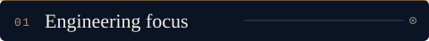

<table>
<tr>
<td width="50%" valign="top"> <b>Space systems and mission engineering</b> Spacecraft design, mission analysis, orbital mechanics, navigation, satellite and CubeSat systems.</td>
<td width="50%" valign="top"> <b>Robotics and embedded systems</b> UAVs, flight controllers, microcontrollers, sensor integration and autonomous systems.</td>
</tr>
<tr>
<td valign="top"> <b>Computational engineering and AI</b> Scientific computing, simulation, modelling and machine learning for engineering problems.</td>
<td valign="top"> <b>Scientific research</b> Astrophysics and dark matter, quantum and theoretical physics, orbital and navigation concepts.</td>
</tr>
</table>

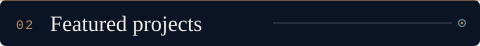

Each description was checked against the repository's code. Simulations here are not flight-tested systems.

### QRNG Spacecraft Navigation
<a href="https://github.com/shrashtimittal/qrng-spacecraft-navigation">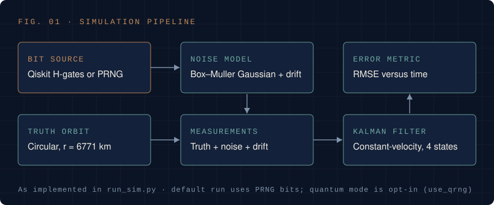</a>

**Question:** does the source of randomness (classical pseudo-random or quantum-sourced bits) change how simulated measurement noise and drift affect a navigation filter? 
**Approach:** a circular low-Earth orbit (r = 6771 km) is the truth trajectory. Random bits are converted to Gaussian noise (Box–Muller), added with a small drift to produce measurements, and a constant-velocity Kalman filter estimates the state; RMSE over time is plotted. Quantum-sourced bits come from a Qiskit Hadamard circuit or an optional public QRNG service. 
**Stack:** `Python` `Qiskit` `NumPy` `Streamlit` &nbsp;·&nbsp; **[Repository →](https://github.com/shrashtimittal/qrng-spacecraft-navigation)** 
Exploratory. Bits fall back to a classical generator if the quantum path is unavailable, no performance advantage is claimed, and it is not flight-validated navigation.

 

### HELIO-OPS Guardian System
<a href="https://github.com/shrashtimittal/HELIO-OPS-Guardian-System">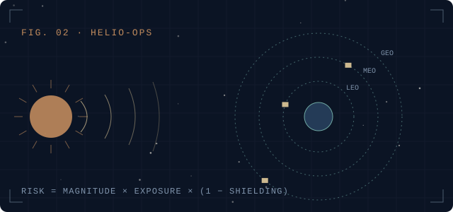</a>

**Question:** how can a solar event be translated into an interpretable operational risk for satellites in different orbits? 
**Approach:** an object-oriented model of solar events and satellites, with risk = magnitude × orbital exposure × (1 − shielding), a reduction for hardened spacecraft, and a safe-mode simulation with console dashboards. 
**Stack:** `Python` `Jupyter` &nbsp;·&nbsp; **[Repository →](https://github.com/shrashtimittal/HELIO-OPS-Guardian-System)** 
A conceptual prototype with a deliberately simplified model and generated scenarios. It does not use live space-weather data.

 

### Team Mimosa: Landsat 7 inspection mission study
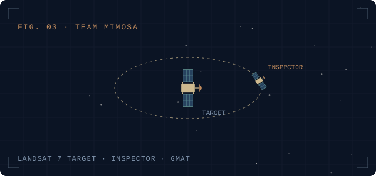

**Question:** which real satellite is a suitable target for a free-flying inspector, and how does the inspection mission behave in simulation? 
**Approach:** a three-person SHE ORBITS 2026 team study: target-satellite selection supported by a decision-support workbook, then a GMAT simulation campaign and a design-status report. 
**Stack:** `GMAT` `Excel` &nbsp;·&nbsp; no public repository 
A summer-school concept study, not a flight programme; the reports are not public.

 

**More work**

| | |
|:--|:--|
| 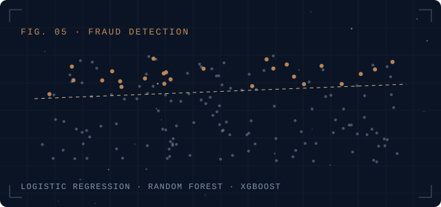 | **[Fraud Transaction Detection](https://github.com/shrashtimittal/fraud-transaction-detection)** Logistic regression, random forest and XGBoost on simulated card transactions with class weighting. `scikit-learn` `XGBoost` |
| 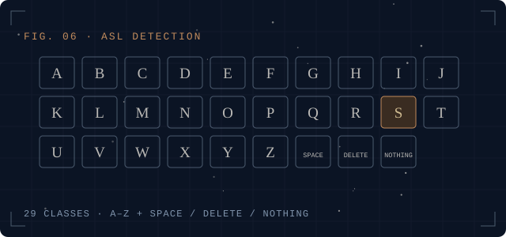 | **[ASL Sign Language Detection](https://github.com/shrashtimittal/asl-sign-language-detection)** EfficientNet-B0 transfer learning on 29 classes, still images, Streamlit interface. `PyTorch` `timm` |
| 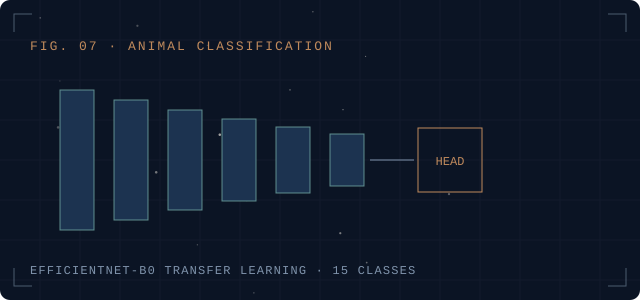 | **[Animal Image Classification](https://github.com/shrashtimittal/animal-image-classification)** 15-class EfficientNet-B0 classifier with a freeze-then-fine-tune schedule. `PyTorch` `timm` |
| 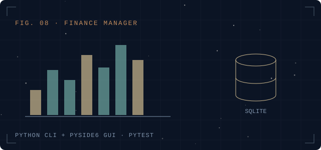 | **[Personal Finance Manager](https://github.com/shrashtimittal/personal-finance-manager-cli)** CLI-first Python application with SQLite, budgets, CSV export and an optional PySide6 GUI. |
| 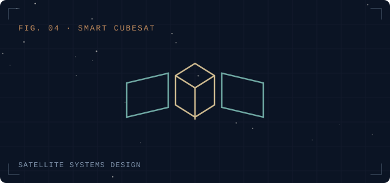 | **Smart CubeSat** Satellite systems design project; public documentation to follow. |

No accuracy figures are quoted for the machine-learning projects because the repositories do not publish them.

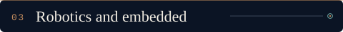

I work with flight-controller and microcontroller platforms for UAV and robotic systems, integrating sensors and writing embedded code in `C/C++` and `Python`.

| Layer | Platforms |
|:--|:--|
| Flight control | `Pixhawk` |
| Onboard computing | `Raspberry Pi` |
| Microcontrollers | `Arduino` `ESP32` `STM32` |
| Focus | Sensor integration, embedded development, autonomy |

Hardware project write-ups will be added here once documented for public release.

**Themes:** astrophysics and dark matter &nbsp;·&nbsp; orbital and navigation concepts &nbsp;·&nbsp; quantum entanglement and theoretical physics &nbsp;·&nbsp; spacecraft systems and mission engineering.

Every entry is labelled with exactly one status: **published**, **conference presentation**, **submitted manuscript**, **ongoing independent research** or **exploratory theoretical work**. Nothing unpublished is presented as peer-reviewed, and no peer-reviewed publication is claimed on this page. Entries appear here with their abstract, PDF and DOI as they become public.

| Domain | Tools |
|:--|:--|
| **Programming and scientific computing** | `Python` `C/C++` `NumPy` `SciPy` `pandas` `Matplotlib` `Jupyter` |
| **Aerospace and mission simulation** | `GMAT` `Qiskit` Kalman filtering, Keplerian orbit simulation |
| **Robotics and embedded** | `Pixhawk` `Raspberry Pi` `Arduino` `ESP32` `STM32` |
| **AI and machine learning** | `PyTorch` `scikit-learn` `XGBoost` `timm` `OpenCV` |
| **Workflow** | `Git` `GitHub` `Streamlit` `SQLite` `pytest` |

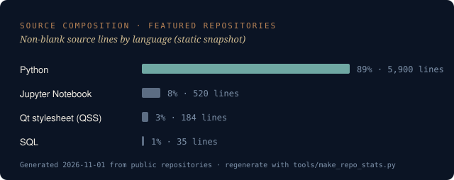

A static snapshot of the featured repositories; live activity is on <a href="https://github.com/shrashtimittal">my GitHub profile</a>.

<table>
<tr>
<td width="72" valign="middle"></td>
<td valign="middle"><b>Shrashti Mittal</b> GitHub: <a href="https://github.com/shrashtimittal">github.com/shrashtimittal</a> For research or engineering collaboration, open an issue or discussion on any repository above.</td>
</tr>
</table>

<!-- Add after confirming what you want public:
LinkedIn: ...   Email: ...   ORCID: ...   Google Scholar: ...
-->

